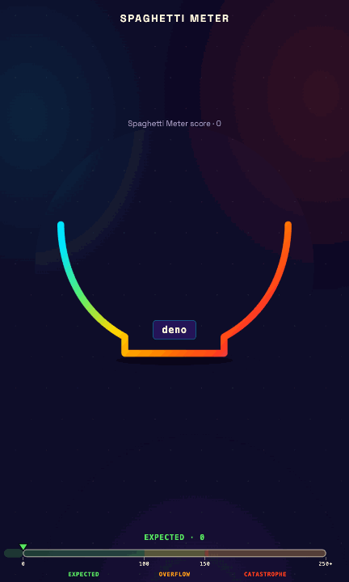

<p align="center">
  
</p>

<h1 align="center">Spaghetti Meter</h1>

<p align="center">
  <strong>Higher score. Better engineer. Probably.</strong>
</p>

<p align="center">
  A local desktop app that turns a project into a bowl of animated spaghetti.
</p>

## Download

[**Download the latest release**](https://github.com/tool-bunker/spaghetti-meter/releases/latest)

Available for macOS ARM64, Windows x64, and Linux x64 (glibc 2.39+, such as Ubuntu 24.04 LTS). [Code Buster](https://github.com/tool-bunker/code-buster) is bundled; no separate installation is needed.

Download new releases manually.

## How it works

1. Choose a project folder.
2. Watch the spaghetti fall into the bowl.
3. Export the result as a PNG image, animated GIF, or silent video.

## See it in action

<picture>
  <source media="(prefers-reduced-motion: reduce)" srcset="media/deno-result.png" />
  
</picture>

[Empty bowl screenshot](media/empty-bowl.png) · [Completed scan screenshot](media/deno-result.png)

## Scoring

Around **100** fills the bowl; higher scores overflow. Scores are playful signals, not software-quality rankings.

Folders without measurable supported code show an empty bowl and **Nothing to measure**, not a zero score or a verdict. Scanner failures still appear as errors.

<details>
<summary>How the score is calculated</summary>

The score measures finding density against analyzed production code, with diminishing returns for repeated findings from the same rule in the same file. Actionable findings retain weight **3**, advisories weight **1**. Naming, style, and security findings still contribute; their categories are not discarded.

Findings are grouped by file, rule, and effective mode. For each group:

```text
L = total analyzed code lines
D = max(L, 1000)
f = max(file code lines, 1)
n = findings in this group
w = 3 for actionable, 1 for advisory

contribution = 100 × w × f / D × log2(1 + 100 × n / f)
score = round(sum(contributions))
```

Project-level findings use `max(L, 1)` for `f`. With measured supported code, no findings means zero; otherwise the score is at least one. The 1,000-line floor dampens tiny-project extremes. Raw finding counts remain unchanged.

Code Buster supplies language-aware code-line measurements for exactly the selected files, including embedded code and excluding its inline test regions. String-literal content remains code, including Python runtime docstrings. Skipped files do not enter the denominator. Scores are capped at the unsigned 32-bit integer limit.

</details>

## Development

Requires Node.js 20+, Rust, and the [Tauri 2 prerequisites](https://v2.tauri.app/start/prerequisites/).

```sh
npm ci
npm run tauri dev
```

See [CONTRIBUTING.md](CONTRIBUTING.md) for verification commands and local engine development, and [RELEASING.md](RELEASING.md) for packaging and distribution.

